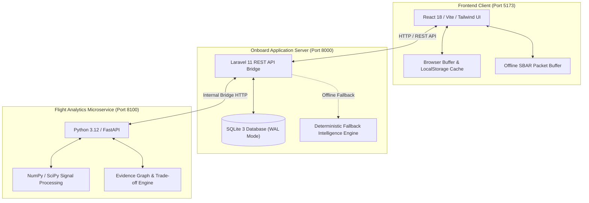

# MOSAIC-9 — FINAL COMPREHENSIVE PROJECT REPORT

**Project Title:** MOSAIC-9 — Mission Health Event Reconstruction for Deep-Space Crews  
**Tagline:** Every Signal Has a Story.  
**Competition:** NASA Space Apps Challenge 2026  
**Category Challenge:** Create Health Monitoring Software for Astronauts on Space Missions  
**Team:** TESSERA FLIGHT LAB  
**Status:** Frozen Verified Baseline v2.7 — Production Ready  
**Repository:** [https://github.com/irfan-ibtech/MOSAIC-9](https://github.com/irfan-ibtech/MOSAIC-9)

---

## 1. Executive Summary

During long-duration crewed exploration missions beyond low Earth orbit (such as the 30-month Mars transit and surface stay), human physiology undergoes continuous, multi-system adaptation to microgravity, space radiation, altered circadian cues, confined habitat acoustics, and high-tempo operational workloads. When clinical decompensations occur—such as orthostatic intolerance, presyncope, severe hypercapnic headache, or cognitive performance collapse—they are rarely acute, isolated accidents. Instead, they represent the cumulative culmination of subtle, multi-day, cross-domain precursor signals that were individually sub-clinical or dismissed as operational friction.

Compounding this challenge is the **communications delay penalty**: in deep space, one-way light time (OWLT) latency ranges between 4 and 21+ minutes, punctuated by planetary occultations and solar conjunctions that create multi-hour or multi-day communication blackouts. Real-time terrestrial telemedicine is physically impossible.

**MOSAIC-9** is an onboard, explainable, and offline-resilient mission health intelligence platform engineered specifically for autonomous deep-space crew health monitoring and clinical incident reconstruction. Rather than functioning as a black-box machine learning classifier or an ungrounded alarm generator, MOSAIC-9 establishes a transparent, six-tier epistemic evidence architecture that:
1. Reconstructs multi-day precursor trajectories leading up to acute medical events.
2. Formulates an interactive Mission Evidence Graph linking onboard telemetry to NASA Open Science Data Repository (OSDR) multi-omics datasets and NASA Human Research Program (HRP) risk evidence.
3. Computes multi-objective countermeasure scenario trade-offs along an empirical Pareto frontier.
4. Maintains 100% data isolation across individual crew members while supporting offline-resilient SBAR clinical communication packets.

---

## 2. Problem Statement & Mission Context

### 2.1 The Deep-Space Health Dilemma
On the International Space Station (ISS), ground-based flight surgeons at Mission Control continuously monitor live biometric streams, video downlinks, and environmental sensors. If an astronaut exhibits early presyncope or hypercapnia, Earth physicians can intervene within seconds. 

During an interplanetary Mars transit (simulated in MOSAIC-9 as the **ARES-IV Deep Space Transit**, Mission Day 120):
- **Communication Blackouts:** Earth is frequently occluded behind Mars or deep-space vehicle structures, causing continuous Loss of Signal (LOS).
- **Latency Delay:** A flight surgeon's voice or text packet sent from Earth requires up to 21 minutes to reach the spacecraft, and the astronaut's response requires another 21 minutes (42-minute minimum round-trip consultation time).
- **Multi-Domain Compounding:** Physiological stressors do not operate in silos. Sleep restriction degrades autonomic vagal tone; suppressed autonomic tone diminishes orthostatic baroreflex compensation; missed cycle ergometer countermeasures accelerate intravascular hypovolemia; and microenvironmental $\text{CO}_2$ pockets exacerbate cerebral vasodilation.
- **Epistemic Confusion:** In previous monitoring prototypes, operators struggled to distinguish between raw sensor readings, model extrapolations, literature analogies, and missing telemetry gaps.

---

## 3. Design Philosophy & Epistemic Evidence Architecture

MOSAIC-9 is built upon four foundational design principles:

### 3.1 Principle 1: Explainable Precursor Reconstruction Over Black-Box Prediction
MOSAIC-9 does not attempt to forecast complex clinical futures using uninterpretable deep neural networks. Instead, it deterministically traces backwards in time across 6-hour, 24-hour, 72-hour, and 168-hour lookback horizons, identifying the exact timestamped sequence of threshold departures ($z$-scores $> |2.0\sigma|$) across all physiological and operational domains.

### 3.2 Principle 2: Six-Tier Epistemic Evidence Classification
Every node, badge, chart, and event in MOSAIC-9 is strictly tagged with its evidentiary origin:
1. `DIRECT_OBSERVATION` (Green): Empirically verified sensor telemetry (e.g., continuous ECG patch, smart bunk bio-acoustics, cycle ergometer load cells).
2. `NASA_RESEARCH_CONTEXT` (Blue): Published spaceflight biomedical research from NASA OSDR or NASA HRP providing biological context (e.g., Inspiration4 multi-omics, ISS vascular smooth muscle transcriptomics).
3. `DERIVED_TEMPORAL_ASSOCIATION` (Purple): Statistically calculated cross-domain linear associations ($n=4\text{–}5, df=2\text{–}3$) with explicit lag times and sample sizes.
4. `EXPLORATORY_HYPOTHESIS` (Amber): Plausible physiological mechanisms linking precursor signals to clinical outcomes (e.g., baroreflex attenuation under hypovolemia).
5. `MISSING_EVIDENCE` (Rose): Documented sensor gaps, lost packets, or omitted countermeasure logs that penalize heuristic confidence scores.
6. `SYNTHETIC_SIMULATION` (Cyan): Forward-looking countermeasure projections generated by deterministic linear physiological approximations.

### 3.3 Principle 3: Strict Cross-Crew Data Isolation
Crew medical records are strictly partitioned. Selecting Dr. Sarah Chen (Nominal Astrobiologist) displays zero anomalies, zero threshold breaches, and baseline stability. Selecting Elena Rostova (Geology Specialist) shows missing telemetry due to sensor dropout, penalizing confidence to 41% without fabricating a false clinical diagnosis.

### 3.4 Principle 4: Human-in-the-Loop Decision Governance
Simulation outputs are permanently labeled:  
$$\text{“SIMULATED DATA · EXPLORATORY SCENARIO · NOT A CLINICAL RECOMMENDATION”}$$  
MOSAIC-9 does not autonomously prescribe medications or change countermeasure protocols; it equips the onboard Crew Medical Officer (CMO) and terrestrial Flight Surgeon with quantitative trade-offs.

---

## 4. System Architecture & Component Responsibilities

MOSAIC-9 utilizes a modern, resilient, decoupled three-tier architecture:

### 4.1 Tier 1: Frontend Client (React 18, TypeScript, Vite, Tailwind CSS)
- **Port:** `5173`
- **Responsibilities:** Renders the 10 application modules, interactive Apache ECharts visualizations, dynamic lookback scrubber, evidence graph canvas, and offline buffer synchronization.
- **Resilience:** Implements `fetchWithFallback` with `localStorage` and compiled in-memory fallback datasets (`initialData.ts`) to ensure uninterrupted UI operation during network disconnects.

### 4.2 Tier 2: Onboard Application Server (Laravel 11, PHP 8.2+, SQLite 3)
- **Port:** `8000`
- **Responsibilities:** Serves RESTful endpoints for missions, crew members, ledger events, health observations, scenario comparisons, and SBAR communication packets.
- **Onboard Deterministic Intelligence:** In the event that the Python analytics service is unreachable or offline, Laravel's `IntelligenceBridgeController` and `ScenarioController` automatically fall back to native PHP deterministic engines, guaranteeing 100% feature availability and data isolation.

### 4.3 Tier 3: Scientific Intelligence Service (Python 3.12, FastAPI, NumPy, SciPy)
- **Port:** `8100`
- **Responsibilities:** High-fidelity signal processing, rolling $z$-score evaluation, lead-lag cross-correlation, multi-scenario Pareto frontier dominance analysis, and one-at-a-time (OAT) sensitivity calculations.

---

## 5. Detailed Walkthrough of Core Modules

### Module A: Mission Operations Command Center
Displays overall spacecraft status: MET Day 120, ARES-IV Transit. Tracks real-time cabin environmental parameters (ambient pressure $101.3\text{ kPa}$, $\text{O}_2$ $21.2\%$, cabin $\text{CO}_2$ $2.8\text{ mmHg}$, dosimeter radiation $52.8\ \mu\text{Sv/h}$). Provides an interactive Deep Space Network (DSN) link switcher allowing operators to simulate Earth line-of-sight vs. occultation.

### Module B: Personal Crew Health Twin
Presents an individual digital health twin for all 4 crew members. Displays a side-by-side comparison between their personal 30-day baseline reference profile ($\mu_{\text{base}}$) and their current Day 120 acute observation ($x_{\text{curr}}$). Evaluates cardiovascular, musculoskeletal, neurocognitive/sleep, and radiation domains with clear baseline departure indicators.

### Module C: Physiological Domain Telemetry
Interactive multi-stream telemetry dashboard rendering resting heart rate, HRV RMSSD, systolic blood pressure, sleep duration, cycle ergometer workload, and Psychomotor Vigilance Task (PVT) reaction latency across Mission Days 114 to 120.

### Module D: Temporal Relationship Intelligence
Calculates and visualizes cross-domain temporal interactions across discrete observation windows:
1. **Sleep Restriction $\leftrightarrow$ Autonomic Tone Suppression:** $r = -0.89$ ($24\text{h}$ lag, $n=5\text{ days}, df=3$, Sleep Deficit vs. HRV RMSSD).
2. **Workload Task Extension $\leftrightarrow$ Countermeasure Non-Compliance:** $r = -0.38$ ($12\text{h}$ lag, $n=4\text{ operational days [Days 116–119]}, df=2$, Workload Shift Hours vs. Ergometer Power Output). Reflects operational schedule competition.
3. **Cumulative Sleep Debt $\leftrightarrow$ Neurocognitive Vigilance Lapses:** $r = +0.93$ ($48\text{h}$ lag, $n=5\text{ days}, df=3$, Cumulative Sleep Deficit vs. PVT Latency).
All associations carry explicit sample size badges and causality qualifications.

### Module E: Health Incident Reconstruction & Mission Event Replay
Dedicated investigation workspace for active incidents:
- `INC-ARES4-120-001`: Commander Alex Morgan acute orthostatic presyncope (BP collapsed to $88/56\text{ mmHg}$, compensatory reflex tachycardia $118\text{ bpm}$).
- `INC-ARES4-118-002`: Lead Engineer Marcus Vance acute workload strain and cephalalgia under elevated cabin $\text{CO}_2$ ($3.5\text{ mmHg}$).
Features an interactive 4-horizon chronological event replay scrubber ($6\text{h}, 24\text{h}, 72\text{h}, 168\text{h}$) allowing surgeons to step through the chronological sequence of precursors.

### Module F: Countermeasure Scenario Sandbox & Pareto Trade-Off Engine
Simulates and compares 5 candidate recovery protocols for Commander Alex Morgan across 8 operational and epistemic dimensions:
1. `SC-BASELINE`: Baseline schedule without changes ($49.8/49.5$ recovery score, zero schedule disruption).
2. `SC-SLEEP-PROTECT`: $+2.5\text{h}$ protected sleep window ($80.8/80.0$ recovery score, $21.3\%$ schedule disruption).
3. `SC-WORKLOAD-REDIST`: $-40\%$ physical duty reduction ($67.0/66.3$ recovery score, $30.0\%$ schedule disruption).
4. `SC-EXERCISE-TAPER`: Graded $135\text{W}$ ergometer with fluid loading ($62.1/61.7$ recovery score; strictly dominated).
5. `SC-COMBINED-ALPHA`: Combined protocol ($88.0/87.1$ recovery score, $45.8\%$ schedule disruption).
Calculates and highlights the mathematical **Pareto non-dominated frontier** across 3 primary maximized objectives: Recovery Score, Operational Continuity ($100 - \text{Schedule Disruption}$), and Exercise Preservation.

### Module G: NASA Evidence Explorer & OSDR Study Integration
Dedicated browser for spaceflight biomedical research, featuring:
- **`OSD-575` / `LSDS-8`** (DOI: `10.26030/mc5d-p710`): Inspiration4 human spaceflight cohort serum multi-omics (4 civilian astronauts, 6 pre/post-flight sample timepoints). Labeled: *Not continuous in-flight monitoring*.
- **`OSD-571` / `GLDS-563`** (DOI: `10.26030/h3p5-tc29`): Inspiration4 plasma profiling across proteomics, metabolomics, cfDNA, and cfRNA.
- **`OSD-635` / `GLDS-608`** (DOI: `10.26030/8n5a-q187`): Spaceflight effects on primary human aortic smooth muscle cells (HASMCs) cultured in microgravity on the ISS. Labeled: *In-vitro cellular transcriptomics, not live hemodynamic monitoring*.
- **NASA HRP Risk Portfolios:** `HRP-CV-OI` (Cardiovascular Adaptations Risk i=179), `HRP-SLEEP-CIRC` (Sleep Loss Risk i=100), `HRP-AERO-MUSC`, and `HRP-ENV-CO2`.

### Module H: SBAR Ground Communication Workspace
Prepares standardized Situation-Background-Assessment-Recommendation clinical consultation briefs. During DSN occultation, briefs are automatically buffered in browser storage and local SQLite database (`QUEUED_LOCAL` status). When the simulated high-gain link resumes, queued briefs synchronize immediately.

### Module I: Mission Health Intelligence Event Ledger
Chronological mission log recording 24 distinct operational, environmental, and physiological events. Every event is verified with an inline SHA-256 cryptographic checksum verifying record provenance and tamper evidence.

### Module J: Interactive Mission Evidence Graph
Directed bipartite graph connecting incident nodes to precursor observations, biological domains, clinical hypotheses, and NASA research studies. Visualizes evidence weight and missing evidence penalties directly on the canvas.

---

## 6. Verification, Testing & Build Integrity

MOSAIC-9 has undergone continuous automated regression testing across all three technology tiers.

### 6.1 Test Suite Accounting
- **Python Intelligence Suite (`pytest`):** 15 automated tests passing ($0.67\text{s}$). Tests signal processing, rolling $z$-scores, cross-correlations, evidence registry, Pareto dominance, and FastAPI endpoints.
- **Laravel Backend API Suite (`phpunit`):** 21 automated tests passing ($0.69\text{s}$, 246 assertions). Tests API routing, database migrations, crew isolation, scenario simulations, and offline queueing.
- **Frontend Logic & Component Suite (`vitest`):** 17 automated tests passing ($0.31\text{s}$). Tests scientific taxonomy, status classifications, SBAR formatting, DSN transitions, and association matching.
- **Total Unique Tests:** **53 unique automated tests** (100% pass rate).

### 6.2 Production Compilation
Executed `npm --prefix frontend run build` (`tsc && vite build`):
- Transformed 2,178 modules cleanly in $2.32\text{s}$.
- Production bundle: `dist/index.html` ($0.90\text{ kB}$), `dist/assets/index-*.css` ($36.35\text{ kB}$), `dist/assets/index-*.js` ($1,551\text{ kB}$ / $475\text{ kB}$ gzip).
- Zero TypeScript compiler errors; zero packaging warnings.

---

## 7. Security, Privacy & Operational Considerations

1. **Synthetic Crew Data:** No personally identifiable human health information (PHI/PII) is contained in the repository. All astronaut names, roles, callsigns, and biometrics are synthetic representations calibrated to published NASA flight parameters.
2. **Local Storage Security:** Onboard SQLite storage and browser `localStorage` buffers are currently unencrypted on the local filesystem. In an operational spaceflight deployment, this would be backed by hardware-encrypted NVMe volumes meeting NASA STD-2817 data-at-rest standards.
3. **No Embedded Secrets:** An adversarial audit confirmed that zero passwords, API tokens, cloud keys, or local credentials exist in source code or committed documentation.

---

## 8. What MOSAIC-9 Is and What It Is NOT

| Claim Area | What MOSAIC-9 IS | What MOSAIC-9 Is NOT |
| :--- | :--- | :--- |
| **Clinical Status** | An explainable decision-support tool that surfaces precursors and trade-offs. | NOT a clinically validated diagnostic device or autonomous medical prescribing system. |
| **Simulation Output** | A deterministic linear approximation for evaluating operational schedule trade-offs. | NOT a guaranteed medical prognosis. |
| **NASA Evidence** | Contextual grounding in NASA OSDR datasets and HRP risk portfolios. | NOT an operational NASA-certified system or official NASA deployment. |
| **Data Nature** | Scientifically calibrated synthetic exploration scenarios. | NOT live telemetry streamed from active space missions. |
| **Offline Scope** | Offline-resilient with local caching and onboard deterministic fallback while services run. | NOT a cold-boot standalone PWA that boots without local web server processes. |

---

## 9. Future Roadmap (Clearly Separated from Implemented Baseline)

The following capabilities are envisioned for future development cycles:
1. **Bio-Acoustic Voice Stress Analysis:** Extracting acoustic biomarkers (pitch jitter, formant drift) from daily crew comms to augment PVT cognitive fatigue scoring.
2. **Continuous NIRS Cerebral Hemodynamic Integration:** Incorporating non-invasive near-infrared spectroscopy of the prefrontal cortex to directly measure cerebral microvascular oxygenation during postural transitions.
3. **Direct Hardware Enclave Encryption:** Integrating AES-256 GCM hardware encryption into the onboard SQLite WAL database for strict HIPAA/NASA Medical Operations compliance.
4. **Autonomous Spacecraft ECLSS Telemetry Ingestion:** Direct streaming interface with spacecraft Environmental Control and Life Support Systems (ECLSS) to correlate cabin trace contaminant spikes with symptom logging.
