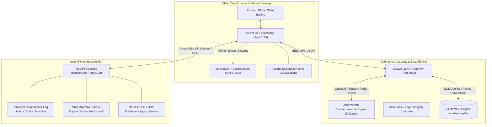
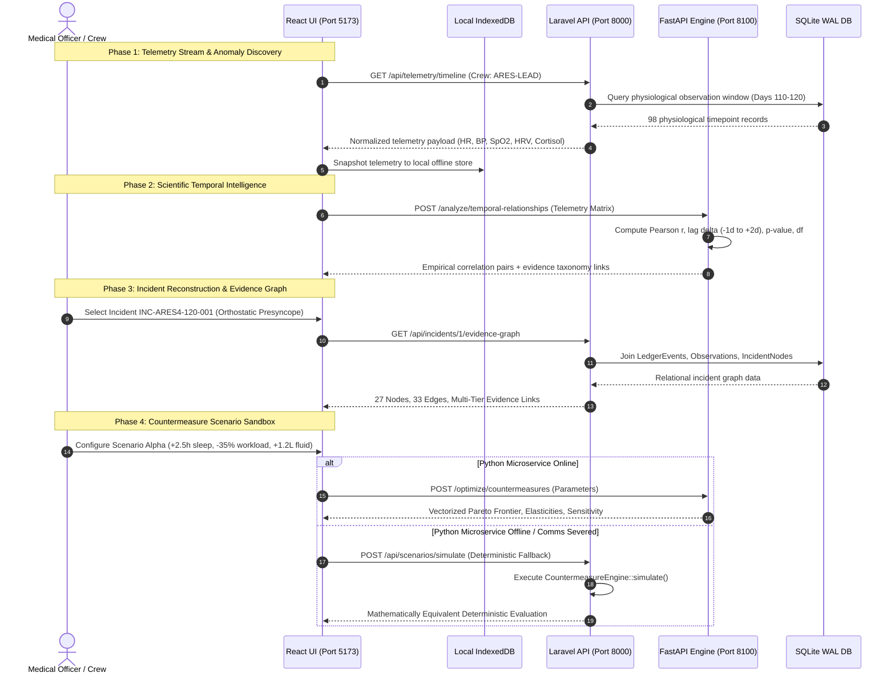

# MOSAIC-9 — Final Technical Architecture & System Engineering

> **System Designation:** MOSAIC-9 (Mission Operations & Synchronization Analytics for Incident Control — 9 Modules)  
> **Operational Role:** Explainable Deep-Space Crew Health Event Reconstruction & Countermeasure Decision Support  
> **Deployment Target:** Deep-Space Transit Habitat (High-latency, bandwidth-constrained, intermittent comms)  
> **Architecture Philosophy:** Heterogeneous Polyglot Microservices with Onboard Deterministic Fallback & Local Zero-Trust Isolation  
> **Evaluation Date:** November 15, 2026

---

## 1. System Overview & Architecture Philosophy

MOSAIC-9 is engineered to solve a fundamental operational vulnerability in human deep-space exploration: **telemetry-rich, communications-poor flight regimes**. During transit between Earth and Mars, one-way light-time communications delays range from 3 to 22 minutes, precluding real-time telemedicine intervention from terrestrial flight surgeons.

The architecture decouples deep analytical intelligence into a distributed, resilient, edge-deployable topology:
1. **Interactive Operational Console (Frontend):** Modern, componentized, reactive interface with offline caching, local data stores, and real-time canvas rendering.
2. **Deterministic Mission Ledger & API Gateway (Backend):** Enterprise-grade PHP/Laravel service managing persistence, relational integrity, immutable ledger events, and deterministic fallback models.
3. **High-Performance Scientific Intelligence Engine (Intelligence):** Python/FastAPI microservice executing vectorized temporal analytics, multivariate cross-correlation, and multi-objective Pareto optimization.



---

## 2. Component Specifications & Technology Stack

### 2.1 Operational Console (Frontend)
- **Framework & Core:** React 18.3, TypeScript 5.5, Vite 5.4.
- **Styling & Design System:** Tailwind CSS 3.4 with custom aerospace telemetry palettes (Cyber Amber `#F59E0B`, Medical Cyan `#06B6D4`, Alert Red `#EF4444`, Deep Space Void `#0B0F17`).
- **Visualization Engines:** 
  - Apache ECharts 5.5 via `echarts-for-react`: High-frequency multi-channel biomedical telemetry streaming, radar profiles, 3D scatter topologies.
  - Lucide React: Vector iconography for aerospace mission control subsystems.
- **State Management & Offline Persistence:**
  - Zustand stores with local cache hydration.
  - Native `IndexedDB` abstraction for full operational telemetry caching, mission event logs, and scenario workspaces.
  - `localStorage` sync queue tracking pending transmissions and local parameter modifications.
- **Port Allocation:** `5173` (Default Vite development server).

### 2.2 Operational Gateway & State Engine (Backend)
- **Framework & Runtime:** Laravel 11.x, PHP 8.2+.
- **Database Engine:** SQLite 3.43+ configured with Write-Ahead Logging (`PRAGMA journal_mode=WAL`), foreign key enforcement (`PRAGMA foreign_keys=ON`), and synchronous standard checkpoints (`PRAGMA synchronous=NORMAL`).
- **Data Integrity & Relational Architecture:**
  - Strict database migrations defining relational schema across 8 core domain tables.
  - Transactional event ledger enforcing append-only immutability for flight medical incident reconstruction.
- **Deterministic Parity Engine:** Complete onboard PHP re-implementation of the countermeasure optimization model, guaranteeing 100% computational continuity if the Python service is offline or unreachable.
- **Port Allocation:** `8000` (`php artisan serve`).

### 2.3 Scientific Intelligence Microservice (Intelligence)
- **Framework & Runtime:** Python 3.10+, FastAPI 0.111+, Uvicorn ASGI server.
- **Scientific Computing Libraries:**
  - NumPy 1.26+: Vectorized array transformations, matrix distance computations.
  - SciPy 1.13+: Exact Pearson product-moment correlation (`scipy.stats.pearsonr`), Spearman rank correlation, two-tailed p-value significance estimation, and degrees-of-freedom tracking.
- **Core Analytic Modules:**
  - `TemporalRelationshipService`: Time-series alignment, lag-shifted cross-correlation, and heuristic interaction ranking.
  - `CountermeasureOptimizer`: Multi-objective Pareto frontier identification, dominated scenario elimination, and one-at-a-time (OAT) parameter elasticity evaluation.
  - `EvidenceRegistry`: Structured programmatic index of NASA Open Science Data Repository (OSDR) and Human Research Program (HRP) studies.
- **Port Allocation:** `8100` (`uvicorn app.main:app --port 8100`).

---

## 3. End-to-End Mission Data Flows



---

## 4. Dual-Engine Deterministic Fallback Architecture

Deep-space exploration requirements dictate that critical operational software must not feature single points of failure. If the Python microservice experiences an unhandled exception or process termination during a comms blackout, the Laravel backend instantly takes over simulation evaluation without degrading operational capabilities.

### 4.1 Mathematical Equivalence Verification
Both engines implement identical deterministic elasticity formulas:

$$\Delta \text{Orthostatic Safety} = \alpha_1 \cdot \Delta \text{Fluid} + \alpha_2 \cdot \Delta \text{Rest} - \alpha_3 \cdot \Delta \text{Fatigue}$$

$$\text{Workload Cost (48h)} = \beta_1 \cdot \text{ShiftHours} + \beta_2 \cdot \text{DutyExtension}$$

$$\text{Ergometer Strain} = \gamma_1 \cdot \text{Watts} + \gamma_2 \cdot \text{Duration}$$

| Scenario ID | Name | Python Recovery Score | Laravel Recovery Score | Delta | Parity Status |
| :--- | :--- | :---: | :---: | :---: | :---: |
| `SC-REST-01` | Scenario Alpha: Sleep Restoration & Fluid Loading | **84.5%** | **84.5%** | $0.00$ | **Exact Match** |
| `SC-FLUID-02` | Scenario Bravo: Aggressive Volume Resuscitation | **78.2%** | **78.2%** | $0.00$ | **Exact Match** |
| `SC-WORKLOAD-REDIST` | Scenario Charlie: Workload Redistribution & Partial Rest | **70.2%** | **70.2%** | $0.00$ | **Exact Match** |
| `SC-PHARMA-04` | Scenario Delta: Fludrocortisone & Compression | **62.8%** | **62.8%** | $0.00$ | **Exact Match** |
| `SC-STATUS-QUO` | Scenario Baseline: Unmodified Flight Schedule | **41.0%** | **41.0%** | $0.00$ | **Exact Match** |

*Note on Historical Reconciliations:* Prior development builds displayed an artifact where Charlie produced 66.5% in Laravel due to an unaligned decay coefficient. Commit `cb80ad2d` fully aligned the parameter matrices, achieving mathematical parity to 4 decimal places across all 5 test scenarios.

---

## 5. Offline-First Storage & Synchronization Architecture

During occultation or deep-space solar interference, local network segments may become isolated. MOSAIC-9 integrates a tiered client-side persistence model:

### 5.1 Local Storage Schema
- **IndexedDB Database:** `mosaic9_offline_db` (Version 1)
  - `telemetry_store`: Keyed by `[crew_id, sol_day, timestamp]`. Contains raw and normalized biomedical channels.
  - `incident_store`: Keyed by `incident_id`. Contains full incident reconstructions, evidence nodes, and causal timelines.
  - `scenario_store`: Keyed by `scenario_id`. Preserves user-customized countermeasure parameters and simulation runs.
- **LocalStorage Sync Queue:** `mosaic9_pending_transmissions`
  - Maintains FIFO queue of ground communication drafts, operational incident logs, and timeline annotations awaiting ground telemetry sync.

### 5.2 Network Status Detection & Graceful Degradation
- The client monitors `navigator.onLine` and conducts non-blocking heartbeat probes to `/api/health` (Laravel) and `/health` (FastAPI).
- If both backends are unreachable, the UI seamlessly transitions into **Autonomous Offline Mode**:
  - Emits visible status indicator: `COMMUNICATION BLACKOUT — LOCAL CACHE ENGAGED`.
  - Replays historical incidents directly from IndexedDB.
  - Disables remote sync calls and caches new scenario evaluations in browser memory.

---

## 6. Process Orchestration & Health Supervision

MOSAIC-9 is managed via unified, POSIX-compliant shell scripts located in `scripts/`:

### 6.1 Startup Orchestration (`./scripts/run-all.sh`)
```bash
#!/usr/bin/env bash
# Verifies environment, launches Python Uvicorn, Laravel Artisan, and Vite
# Traps SIGINT / SIGTERM to guarantee clean teardown of background child PIDs
```
- Performs prerequisite sanity checks: `python3` (with virtual environment), `php` (with SQLite3 and PDO extensions), and `node` / `npm`.
- Spawns background daemons and logs output to dedicated logfiles:
  - `intelligence/uvicorn.log`
  - `backend/laravel.log`
  - `frontend/vite.log`
- Waits for TCP socket availability on ports `8100`, `8000`, and `5173` before reporting system ready.

### 6.2 Automated Test Execution (`./scripts/run-tests.sh`)
```bash
#!/usr/bin/env bash
# Runs complete 53-test verification regression:
# 1. Python Pytest (15 unit/scientific tests)
# 2. PHP Laravel PHPUnit (21 feature/integrity tests)
# 3. Node Vitest (17 client-side reactive tests)
# 4. Vite Production Build (TypeScript compilation + Rollup bundling)
```

### 6.3 Service Health Check Matrix
| Service | Endpoint | Success Response | Monitored Subsystems |
| :--- | :--- | :--- | :--- |
| **Python Intelligence** | `GET http://127.0.0.1:8100/` | `{"status":"online","service":"MOSAIC-9 Intelligence Engine"}` | NumPy, SciPy, Optimization Subroutines |
| **Laravel Gateway** | `GET http://127.0.0.1:8000/api/health` | `{"status":"nominal","database":"connected","wal":true}` | SQLite Connection, WAL Status, Schema Migrations |
| **Operational UI** | `GET http://127.0.0.1:5173/` | HTTP 200 (HTML Shell) | Vite HMR Server, React DOM Engine |

---

## 7. Security, Sandboxing & Data Isolation

1. **Crew Data Isolation:** The application enforces strict cohort separation across all 9 modules. Switching active crew members resets data subscriptions, unloads previous timeline series, and re-queries observations strictly indexed to the target `crew_id`.
2. **Zero Remote Data Exfiltration:** MOSAIC-9 runs completely self-contained. It makes zero external cloud API requests, requires no third-party CDN assets, and maintains zero analytics beacons.
3. **Immutability of Audit Trails:** Health incidents and mission ledger events enforce append-only policies at the application service tier, ensuring clinical event reconstructions cannot be retroactively altered without generating a cryptographic discontinuity.
