# MOSAIC-9 — Final 3–5 Minute Competition Demonstration Script

**Project:** MOSAIC-9 — Mission Health Event Reconstruction for Deep-Space Crews  
**Team:** TESSERA FLIGHT LAB (NASA Space Apps Challenge 2026)  
**Target Duration:** 3 to 5 Minutes  
**Demonstration Setup:** All services running via `./scripts/start-all.sh`. Open `http://localhost:5173` in a desktop browser.

---

## Demonstration Narrative Overview

```mermaid
flowchart LR
    Step1["1. Command Center"] --> Step2["2. Select Crew"]
    Step2 --> Step3["3. Baseline Twin"]
    Step3 --> Step4["4. First Anomaly"]
    Step4 --> Step5["5. Event Ledger"]
    Step5 --> Step6["6. Incident Select"]
    Step6 --> Step7["7. 72h Reconstruction"]
    Step7 --> Step8["8. Inspect Evidence"]
    Step8 --> Step9["9. Missing Evidence"]
    Step9 --> Step10["10. Scenario Sandbox"]
    Step10 --> Step11["11. SBAR Ground Brief"]
    Step11 --> Step12["12. Offline Queue & Sync"]
```

---

## Step-by-Step Script & Presentation Cues

### Step 1: Mission Command Center (0:00 – 0:30)
- **Action:** Open the application. Ensure you are on the **Mission Command Center** (`CommandCenterScreen`).
- **Visual Callouts:**
  - Mission Elapsed Time: `Day 120, MET 2894:14:00`.
  - Habitation Environment: Cabin Pressure `101.1 kPa`, Oxygen `20.9%`, Cabin CO2 `3.2 mmHg`.
  - Communication Status banner: `LOSS OF SIGNAL (OCCULTATION)` with a `21.0 Minute` one-way light delay to Earth.
  - Crew Overview cards: 1 Stable (Dr. Sarah Chen), 1 Watch (Marcus Vance), 1 Review Required (Commander Alex Morgan), 1 Unknown (Elena Rostova).
- **Spoken Script:**
  > *"Welcome to MOSAIC-9: Mission Health Event Reconstruction for Deep-Space Crews. We are simulating Day 120 of the ARES-IV transit to Mars. Notice that Earth communications are currently occluded behind Mars, creating a 21-minute one-way speed-of-light delay. The crew must operate with autonomous health intelligence.
  > Notice specialist Elena Rostova’s status: it reads 'UNKNOWN', not healthy. Because her RF biometric telemetry dropped out, MOSAIC-9 penalizes diagnostic confidence rather than masking absence of data as normal."*

---

### Step 2: Crew Member Selection (0:30 – 0:50)
- **Action:** Click on the crew card for **Commander Alex Morgan**.
- **Visual Callouts:**
  - Status updates to `REVIEW_REQUIRED`.
  - Explanation banner displays: *Acute orthostatic dizziness episode recorded on Day 120 following cumulative 72-hour sleep debt, curtailed cycle ergometer countermeasure, and high EVA prep workload.*
  - Domain status badges show: Cardiovascular (`WATCH`), Musculoskeletal (`WATCH`), Neuro-Cognitive Sleep (`REVIEW_REQUIRED`), Radiation (`STABLE`).
- **Spoken Script:**
  > *"We select Commander Alex Morgan. His status has flipped to 'REVIEW REQUIRED'. A conventional dashboard would simply flash a red light for low blood pressure. But MOSAIC-9 asks: What changed before this incident? When did the first unusual signal appear? And what is the underlying story?"*

---

### Step 3: Personal Crew Health Twin (0:50 – 1:15)
- **Action:** Click **"Crew Health Twin"** in the left sidebar navigation.
- **Visual Callouts:**
  - Personalized baseline metrics: Resting HR 60 bpm, HRV 58 ms, Systolic BP 118 mmHg, Sleep Target 8.0h, PVT Reaction 215 ms.
  - Multi-day sleep duration bar chart showing progressive sleep debt: 7.8h on Day 116, dropping to 5.4h, 4.9h, 5.1h, and 4.6h. Bars below 6.0h turn rose.
  - Autonomic balance chart (HRV RMSSD) showing progressive decline in HRV RMSSD from 58 ms down to 27 ms.
- **Spoken Script:**
  > *"Every astronaut has a unique physiological baseline. In the Crew Health Twin, we see Alex Morgan’s individualized parameters. Over Days 117 through 120, his sleep duration dropped below 5 hours, while his heart rate variability dropped from 58 milliseconds to 27 milliseconds, reflecting marked autonomic balance alteration consistent with cumulative fatigue."*

---

### Step 4: First Unusual Signal & Temporal Intelligence (1:15 – 1:45)
- **Action:** Click **"Temporal Intelligence"** in the left sidebar navigation.
- **Visual Callouts:**
  - **Earliest Anomaly Detector Card:** Highlights Day 117 at 06:30 MET — *Sleep curtailment to 5.4h following unscheduled false alarm drill*.
  - **Composite Z-Score Deviation Chart:** Traces multi-sigma divergence leading up to Day 120.
  - **Discovered Cross-Domain Associations:**
    - Sleep Restriction ➔ Autonomic Tone Alteration (Lead time: 24h, $r = -0.89$).
    - Workload Task Extension ➔ Countermeasure Omission (Lead time: 12h, $r = -0.38$, $n=4, df=2$).
    - Cumulative Sleep Debt ➔ Vigilance Lapses ($r = +0.93$).
- **Spoken Script:**
  > *"In Temporal Intelligence, our analytical engine pinpoints the exact earliest signal: Day 117 at 06:30 MET, when an ECLSS false alarm drill curtailed Alex's sleep.
  > The engine also calculates cross-domain lead-lag relationships. For instance, sleep restriction preceded HRV suppression by 24 hours ($r = -0.89$). Notice our scientific boundaries: we clearly state this is an observed linear association, never claiming correlation proves causation."*

---

### Step 5: Chronological Event Ledger (1:45 – 2:10)
- **Action:** Click **"Event Ledger"** in the left sidebar navigation.
- **Action:** Type `"dizziness"` into the search input.
- **Visual Callouts:**
  - Instant filtering isolates event `EVT-120-0942-INC` (*CRITICAL INCIDENT: Acute Orthostatic Dizziness Episode*).
  - Click **"Inspect Records"**: Modal opens displaying raw timestamp (`2026-11-15T09:42:00Z`), sensor source (*Continuous Bio-Patch Telemetry*), and data quality (*VERIFIED*).
- **Spoken Script:**
  > *"Module B is the Mission Health Intelligence Ledger—an immutable chronological log. Typing 'dizziness' instantly isolates the critical incident on Day 120. Clicking 'Inspect' reveals full provenance metadata, calibration timestamps, and sensor sources. Every single event is traceable."*

---

### Step 6 & 7: Incident Reconstruction, Mission Evidence Graph & Replay (2:10 – 2:45)
- **Action:** Click **"Incident Reconstruction"** in the left sidebar navigation.
- **Action:** Verify `INC-ARES4-120-001` is selected.
- **Action:** Click through the lookback horizon buttons: `6h` (3 nodes) ➔ `24h` (7 nodes) ➔ `72h` (12 nodes). Leave it on `72h`.
- **Action:** Inspect the **MISSION EVIDENCE GRAPH** panel and click on node **`NASA-OSD-575`** and **`NASA-OSD-635`** to show source attribution, DOI, organism, and explicit applicability boundaries.
- **Action:** Click **"START REPLAY"** on the **Mission Event Replay** bar to step chronologically through the stored precursor timestamps.
- **Visual Callouts:**
  - 6-tier Evidence Classification Taxonomy pills: `SYNTHETIC OBSERVATION (MISSION RECORD)` (`DIRECT_OBSERVATION`), `NASA_RESEARCH_CONTEXT`, `DERIVED_TEMPORAL_ASSOCIATION`, `EXPLORATORY_HYPOTHESIS`, `MISSING_EVIDENCE`, `SYNTHETIC_SIMULATION`.
  - Mission Evidence Graph connects precursor events, 4 health domains, `OSD-575 / LSDS-8` (Inspiration4 serum metabolic/cytokine study, Dataset DOI `10.26030/mc5d-p710`), `OSD-635 / GLDS-608` (ISS vascular smooth muscle cell RNA-Seq study, Dataset DOI `10.26030/8n5a-q187`), NASA HRP Risk records (`risk.aspx?i=179`, `risk.aspx?i=100`), hypotheses, and missing measurements.
- **Spoken Script:**
  > *"This is MOSAIC-9’s signature capability: Incident Multi-Domain Reconstruction and the Mission Evidence Graph.
  > Adjusting the lookback window from 6 hours to 72 hours reconstructs all 12 precursor nodes. In the Mission Evidence Graph, we link synthetic onboard telemetry directly to published NASA Open Science Data Repository studies—such as OSD-575 (LSDS-8) from the Inspiration4 cohort and OSD-635 (GLDS-608) on human vascular smooth muscle cells in microgravity—while explicitly noting that OSD-575 is pre/post-flight serum data and OSD-635 is in vitro cellular transcriptomics, not continuous wearable telemetry.
  > Using Mission Event Replay, we can also step chronologically through every stored timestamp to watch the anomaly sequence unfold without claiming chronological order proves clinical causation."*

---

### Step 8 & 9: Evidence Library, Missing Evidence & Hypotheses (2:45 – 3:15)
- **Action:** Scroll down to **"Missing Evidence & Data Limitations"** and **"Competing Physiological Hypotheses"**, then briefly click **"NASA EVIDENCE LIBRARY"** (`DataSourcesScreen`) to show search/filtering across NASA OSDR and HRP studies.
- **Visual Callouts:**
  - Missing Evidence Node 1: *Intravascular Fluid Volume Direct Telemetry* (reduces confidence from 98% to 88%).
  - Missing Evidence Node 2: *Cerebral Tissue Oxygenation (NIRS)* (forehead NIRS sensor unacquired).
  - NASA Evidence Library: Filter by `NASA_OSDR`, `NASA_HRP`, domain, and organism; test live/cached OSDR lookup for `OSD-575` and `OSD-635`.
- **Spoken Script:**
  > *"Equally important is what was not measured: MOSAIC-9 explicitly surfaces missing cerebral NIRS oximetry and direct plasma volume telemetry, penalizing confidence rather than guessing. And in our searchable NASA Evidence Library, flight surgeons can filter OSDR and HRP studies by health domain, organism, and study design with offline-resilient caching."*

---

### Step 10: Countermeasure Scenario Sandbox, Trade-Off Engine & Sensitivity Analysis (3:15 – 3:45)
- **Action:** Click **"Scenario Sandbox"** in the left sidebar navigation.
- **Action:** Click **"LOAD ALPHA"** and **"EXECUTE SIMULATION MODEL"**.
- **Action:** Scroll down to the **Multi-Objective Scenario Trade-Off Comparison Engine** (comparing 5 scenarios across 8 dimensions + Pareto frontier) and the **Parameter Sensitivity Analysis** table (`±25%` perturbation). Click **"DECISION REPORT"** and export the JSON package.
- **Visual Callouts:**
  - 5 canonical scenarios evaluated side by side across 8 dimensions (Recovery Trajectory, Sleep Opportunity, Workload Distribution, Exercise Preservation, Schedule Disruption, Environmental Constraints, Completeness, Uncertainty).
  - Pareto non-dominated frontier badges (`PARETO FRONTIER`) without declaring a single medically optimal prescription.
  - Sensitivity analysis ranks *Sleep Restoration -> HRV Coefficient* and *Electrolyte Fluid -> Systolic BP Gain* as the top drivers.
  - Explicitly labeled: `SIMULATED DATA`, `EXPLORATORY SCENARIO`, `NOT A CLINICAL RECOMMENDATION`.
- **Spoken Script:**
  > *"How should the crew respond? In the Scenario Sandbox and Trade-Off Engine, we compare five operational countermeasure configurations side by side across eight physiological and schedule-disruption dimensions. Rather than claiming a single medically optimal prescription, MOSAIC-9 identifies the Pareto frontier, runs One-at-a-Time parameter sensitivity analysis across uncertain biological coefficients, and exports a structured Mission Decision Report for Flight Surgeon review."*

---

### Step 11: Ground Communication Draft (3:45 – 4:15)
- **Action:** Click **"Ground Comms"** in the left sidebar navigation.
- **Visual Callouts:**
  - SBAR Brief Builder pre-fills Situation, Background, Assessment, and Recommendation.
  - Linked Evidence Ledger IDs: `EVT-117-0630-SLP`, `EVT-118-1015-EXE`, `EVT-119-1000-EXE`, `EVT-120-0942-INC`.
  - Questions for Ground Flight Surgeon and explicit data limitations.
- **Action:** Click **"QUEUE GROUND BRIEF (OFFLINE)"**.
- **Visual Callouts:**
  - Emerald banner appears: *Ground communication brief successfully queued in onboard storage (QUEUED_LOCAL).*
- **Spoken Script:**
  > *"Next, the crew prepares an operational consultation for Earth flight surgeons using the aerospace-standard SBAR format: Situation, Background, Assessment, and Recommendation.
  > When we click 'Queue Ground Brief', the packet is saved into local SQLite storage and buffered client-side with status 'QUEUED_LOCAL'."*

---

### Step 12: Offline Resilience, Link Simulation & Sync (4:15 – 4:45)
- **Action:** Click **"System Status"** in the left sidebar navigation.
- **Visual Callouts:**
  - Earth DSN Link is in `LOSS OF SIGNAL`.
  - Onboard database integrity is `100.0%` (SQLite WAL mode).
  - Offline Queue Length: `1` packet queued.
- **Action:** Click **"TRIGGER GROUND SYNC"**.
- **Visual Callouts:**
  - Notification displays: *Sync failed: Link is currently in LOSS_OF_SIGNAL. Onboard local persistence active.* (Queue remains intact).
- **Action:** Click **"HIGH GAIN PASS"** button on the link simulator.
- **Action:** Click **"TRIGGER GROUND SYNC"** again.
- **Visual Callouts:**
  - Link establishes; queued packet is flushed and delivered to the simulated Earth ground flight surgery receiver!
- **Action:** Click **"EXPORT DIAGNOSTIC SNAPSHOT"**. Browser immediately downloads `mosaic9_diagnostics_day120.json`.
- **Spoken Script:**
  > *"Finally, in System Status, we demonstrate offline survivability. When we attempt to synchronize during planetary occultation, the system refuses to drop packets and maintains local integrity.
  > Once the spacecraft acquires a High-Gain pass, triggering ground sync immediately flushes our queued SBAR brief to Earth ground operations.
  > The crew can also export a structured JSON diagnostic snapshot at any moment without needing an internet connection.
  > 
  > MOSAIC-9: Every signal has a story. Thank you."*
